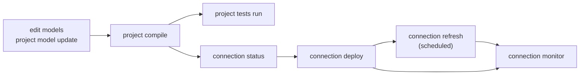

# Concepts: project and connection, deploy and refresh

> **Status, 2026-10-12.** Built: the commands below (entry 135) except the ones the implementation plan lists as *later* (`connection inspect`, `project model create`, `project tests list`, `connection tests run`); the connection is the first positional argument of a command (`connection deploy <c>`, optional when the project has one default connection; there is no `--connection` option on these, and `project compile` and `project model create` keep `--connection` as a filter that takes several); the compiled refresh plan and its checks (`none`, `project`, `objects`, `live`); tracking layout 5 (each event records its lane, and a deploy the structure it was made from) and layout 6 (the words about objects: title, description, tags, properties); the `plans:`, `refresh:` and `retention:` settings are read and act (`keep: committed|database|ephemeral`, `audit` for both lanes, the statement-log retention). Not yet: the deploy event as an id of its own and the drill-down of `connection monitor` (`docs/research/lifecycle-implementation.md`, phases 5 and 6). `docs/commands.md` is generated from the program and is always what exists now.

## The two things you work on

* A **project** is a directory of models. Working on it is **offline**: it reads and writes files and never opens a database.
* A **connection** is a database the project is built on. Working on it is **online**.

## The four questions you ask of a connection

| You want to know or do | Command | Changes the database? |
|---|---|---|
| Where does it stand? | `dbdatabuild connection status <c>` | no |
| Make its structure match the models | `dbdatabuild connection deploy <c>` | **structure** (tables, views, indexes) and the tracking tables |
| Bring its data up to date | `dbdatabuild connection refresh <c>` | **data**, never structure |
| What happened? | `dbdatabuild connection monitor <c>` | no |

*Deploy* is rare, reviewed, and records what it changed. *Refresh* is frequent, usually unattended, and repeats the same statements. A refresh that would need a structure change stops and tells you to deploy.



## What a command reads and writes

Every command says, in its header and in `--help`, what it touches:

| Code | Reads | Writes | In words |
|---|---|---|---|
| `P→` | project | nothing | safe to run any time |
| `P⇒P` | project | project files | edits or generates files |
| `C→` | connection | nothing | reads the database only |
| `C→P` | connection | project files | reads the database to write files |
| `P⇒T` | project | tracking tables | records metadata or a decision |
| `P⇒S` | project, connection | **structure** | changes what exists |
| `P⇒D` | project, connection | **data** | moves data |
| `—` | nothing | nothing | reference text, or a server that hosts commands |

## Commands

### Working on the project (offline)

| Command | What it does | Disposition |
|---|---|---|
| `project create <dir>` | start a project from a template | `P⇒P` |
| `project model create <schema.object>` | add a model | `P⇒P` |
| `project model update [models]` | write or update the definitions of models from their queries, and the mapped models from their tables (`--offline` reads no connection) | `C→P` |
| `project update [selectors]` | `project model update` for every model, plus the dialect each Flight SQL server reports (`dialects.lock.yml`); `--offline`, `--check` | `C→P` |
| `project compile [models]` | check the project and write the compiled files (`rendered/`, refresh plans); `--check` for CI | `P⇒P` |
| `project tests run [tests]` | run the project's tests | `P→` |
| `project sample <models>` | run models on sample data | `P→` |
| `project seed` | build the sample rows of the mapped models | `P⇒P` |
| `project import <c> [tables]` | export a connection's tables as models | `C→P` |
| `project show loads\|graph\|metadata\|plan` | read-only views | `P→` |
| `project agent-kit` | install the skill for AI agents | `P⇒P` |

### Working on a connection (online)

| Command | What it does | Disposition |
|---|---|---|
| `connection inspect <c>` | can the tool use this connection, and if not why | `C→` |
| `connection init <c>` | create the tracking tables | `P⇒T` |
| `connection status <c>` | structure, data and what needs attention | `C→` |
| `connection deploy <c>` | change structure (interactive; or `--write-plan` then `--apply-plan`) | `P⇒S` |
| `connection refresh <c>` | run the routine loads | `P⇒D` |
| `connection monitor <c>` | the timeline of deploys and refreshes | `C→` |
| `connection compare <c> <table>` | compare the data of two tables | `C→` |
| `connection seed <c>` | put sample data into a sandbox database | `P⇒S` |
| `connection publish <c>` | store the project's metadata in the database | `P⇒T` |

### Interfaces and help

| Command | What it does |
|---|---|
| `ui terminal`, `ui mcp` | the terminal interface, the MCP server for AI agents |
| `help code <code>` | explain a diagnostic such as `DDB-214` |
| `help matrix` | the support matrix |
| `help dialects` | the dialect profiles of read-only origins: fields, built-ins, how to add one |

Model kinds (view, full, incremental, copy, mapped, native) and how each operates are in `docs/models.md`. All of them are models: a selector (`kind:mapped`, `+model`, `tag:`), the dependency graph, the counts, the metadata documents and the views, the terminal interface and the web page treat a mapped or native model like a built one; only the commands that build skip the two the tool does not build.

## Plans and events

A **plan** is a list of steps (statements, their risk and why). An **event** is one run of a plan. Ten refreshes a day are ten events that point at one plan.

* A **deploy plan** is made from the database's live state, so it can go stale. It is shown to you, you give the allowances for risky steps, and it is applied. A completed deploy plan cannot be applied twice. If a deploy stops part-way, running the same plan again continues it.
* A **load** moves rows into a model's table (an incremental load, a backfill, a reload of a range, a copy: they differ in strategy and in the values they need, not in kind). A **refresh plan** is a named, project-wide set of loads for a connection (`hourly`, `daily`), run in dependency order. The project declares its plans (`refresh: { plans: { hourly: { expected_every: 1h } } }` in `dbdatabuild.yml`) and each model says which plans its loads are in (`refresh:` in the model or, layered like `tags`, in a folder's `_dbdatabuild.yml`); a model with a default load and no `refresh:` is in the plan `default`. A **membership** is one place a load is in a plan, with its own name (`as:`) and the values it gives for the load's inputs.
* Compiling (`rendered/<connection>/`) writes every load of the connection as a **load plan** in `loads.yml` and one `refresh/<plan>.yml` per plan whose members name their load plan by hash. They are made from the project alone and committed like code: they document how the project operates every day. Values only known at run time (watermarks) are found when the refresh runs and recorded in the event, not in the plan. `connection refresh [plan] [selectors]` reads these files and the committed scripts they name; it does not load the models (only a selector such as `tag:` does). Each load ends done, failed, skipped (upstream failed, busy, stopped, check failed) or not run, and the plan's `on_failure` (`stop`, `continue`, `ignore`) says what a failure does to the rest; the run ends `completed`, `completed_with_failures`, `stopped` or `failed`, and `connection refresh <plan> --only-failed` repeats what did not finish. A load is locked while it runs (`on_busy: skip | wait | fail`), so two refreshes run side by side unless they want the same load, and a deploy waits for none of them: it is refused (exit 4). `max_runtime` cancels a load that runs too long; `expected_every` makes `status` and `monitor` say overdue or slow. Loads that do not read each other can run together: `parallel: 3` on a plan or `--parallel 3` on the command starts a load once the loads of the plan that it reads are done, up to that many at once, each on sessions of its own (the default 1 is one after another); `max_parallel` on a connection caps the sessions one refresh opens there, so a fan-in copy cannot flood a shop's system. Under `stop` the loads already running finish and none starts; the results are listed in the order of the plan. A person can override any input of any load with `--input`; the event records every value and where it came from (`flag`, `membership`, `parameter`, `default`, `resolver:expression`, `resolver:target`, `resolver:source`, `initial`).
* A **copy** is a load too. It is a member of a plan like any model (`refresh:` in the copy's file, or `default` when it has none), and the refresh runs it in dependency order, before the models that read the copied table. For each origin, in turn, it checks that the origin's read login is in the environment and that the origin answers (a failure is `failed: origin`, the origins before it stay loaded, and `on_failure` applies), stages the origin's rows on the destination, loads them with the copy's strategy under the destination's load lock, and drops the staging table at the end. An incremental copy (`watermark:`) reads each origin from the newest value the destination holds for it, less the lookback. To re-read in full (and so also remove rows deleted at the origin) a copy declares a second load, `loads: { default: {...}, full: { strategy: full_replace } }`, and a plan or a person picks it (`refresh: { weekly: { load: full } }`, or `connection refresh <connection> <copy>.full`); there is no flag that re-reads everything. A `source` resolver of a copy runs in a refresh at the origin, as in a deploy.
* An **input** is a value a load needs (`start`, `end`, `days`). A model declares them under `inputs:` with a type, a default and/or a **resolver** that computes the value when the load runs: an `expression` (DuckDB evaluates it inside the tool, with no database, on one frozen clock for the whole run: `current_date - days`), a `target` (a `SELECT` over the project's models, lowered for the engine and run on the connection with the read login, exactly one row) or a `source` (the same at the origin of a copy). `timezone:` in `dbdatabuild.yml` (or on a connection) says what `current_date` means; UTC when absent. A value given with `--input` or in a membership replaces the resolver, which is then not run. NULL goes to the input's `on_null` (`fail`, `initial`, `skip_load`). `connection refresh --dry-run` and `project show refresh <plan> --resolve` show the values before anything runs.
* A **deploy** computes its inputs when it plans and shows them in the plan; **apply computes them again, and if any is another value (a clock-based input moves at midnight) it stops before anything runs**, shows each moved input with the planned and the new value, and an interactive apply asks whether to continue with the new values. A non-interactive apply exits 1 and prints each override as it would be typed (`--input marts.fct.backfill.start=2026-02-27`) to append to the same command. `--yes` does not approve moved inputs; pinning an input with `--input` when planning means it is not computed, so it cannot move (DDB-454).

Where plans are kept, and how much is recorded, is the project's choice:

```yaml
plans:
  deploy:  { keep: committed, audit: full }      # plans/ in git, text also in the database
  refresh: { keep: committed, audit: standard }  # compiled plan in git; each event stores the plan hash
connections:
  dev:  { plans: { deploy: { keep: ephemeral, audit: minimal } } }   # made and applied in one step
```

| `keep` | In the project | In the database |
|---|---|---|
| `committed` | a file | yes |
| `database` | no | yes, in `plan_store`: `connection deploy --write-plan` keeps the plan there (it needs the tracking connection's write login) and prints its id; `connection deploy --apply-plan <id>` applies it |
| `ephemeral` | no | the hash only |

| `audit` | Recorded |
|---|---|
| `minimal` | the event and its steps |
| `standard` | adds the plan's hash, who ran it and the commit |
| `full` | adds the plan text and the statement log |

The tool records what happened to match the policy. It does not decide who reviews or approves.

## Before a refresh runs

A refresh can run without asking the database anything, or check first. The project's `refresh.check` (and `--check`) chooses:

| Level | Checks | Asks the database |
|---|---|---|
| `none` | nothing; the engine's own errors are the check | nothing |
| `project` | that the project's structure was deployed to this connection | the tracking tables |
| `objects` (default) | each object the refresh uses against what was last deployed | the tracking tables |
| `live` | each object against the database as it is now (also catches changes made outside the tool) | the catalog and the tracking tables |

When a check fails the refresh stops (`refresh.on_fail: block`) and names the objects that are behind and the deploy that last touched them; with `warn` it reports and runs anyway.

## Terms

| Term | Meaning |
|---|---|
| connection | a named database the project is built on |
| engine | what kind of connection it is, as keywords in `engine:` (any order): the driver (`sqlserver`, `postgres`, `fabric`, `duckdb`, `odbc`, `flightsql`), `readonly`, and a dialect where the driver has none of its own |
| readonly | a connection the tool only reads: a copy's origin, a mapped or native model's, a `source` resolver's. It has no write login and is never a destination, a tracking connection or a deploy, refresh, seed, publish or init target |
| origin | a connection a copy (or a mapped or native model) reads from; it needs only a read login. A DuckDB file (`readonly duckdb`) or any system with an ODBC driver (`readonly odbc`) or an Arrow Flight SQL server (`readonly flightsql`) can be one; the tool ships no ODBC driver manager or driver |
| dialect | the SQL an origin takes: how a name is quoted, how a parameter is written, what to send to see it answers, where the catalog is read from (`information_schema`, the ODBC driver's own functions, or nowhere). It is the dialect of the system a connection reaches, not of the server in front of it (a proxy in front of PostgreSQL and SQL Server is two connections, `readonly flightsql postgres` and `readonly flightsql sqlserver`). Built in for the three engines, DuckDB and `ansi`; a project adds its own under `dialects:` (`help dialects`) |
| lane | deploy or refresh |
| event | one run of a plan, with an id like `dep-20261007T204550-a7f3` or `ref-…` |
| tracking tables | the tables the tool keeps in the database: plans, events, steps, shape history, decisions, the metadata documents (one per model of any kind, with the model kind) and what each model depends on (`metadata_dependency`) |
| statement log | a local file of each statement, written before it is sent |
| shape hash | the hash of an object's columns, types and nullability |
| drift | an object changed outside the tool |
| acknowledgement | a decision you record (with a reason) so the tool stops blocking on it |
| allowance | permission to run a risky or destructive step |
| backfill | reloading historical ranges of an incremental model |

The full lookup tables (terms, settings, every command with every parameter) are in `docs/research/lifecycle-model.md`, sections 7, 7a and 11.

## Exit codes

`0` done, `1` findings (a refused plan, a failed step or check, a difference found by `status`), `2` usage, `3` not implemented, `4` busy (a deploy could not get the lock of the whole connection because another deploy or a running load holds it; a refresh that finds a load held applies its `on_busy` instead), `70` internal error.
