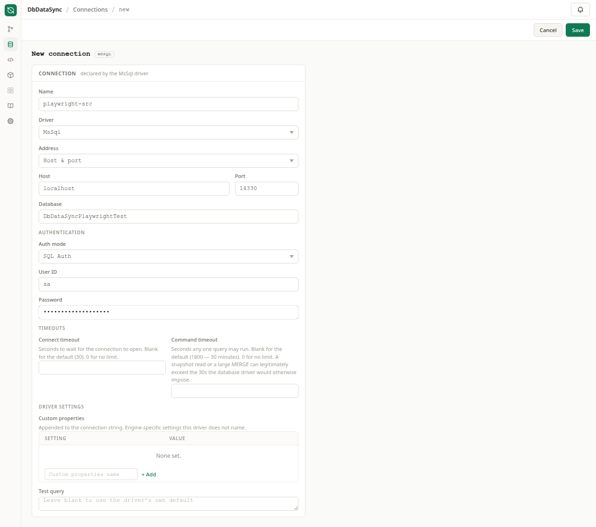
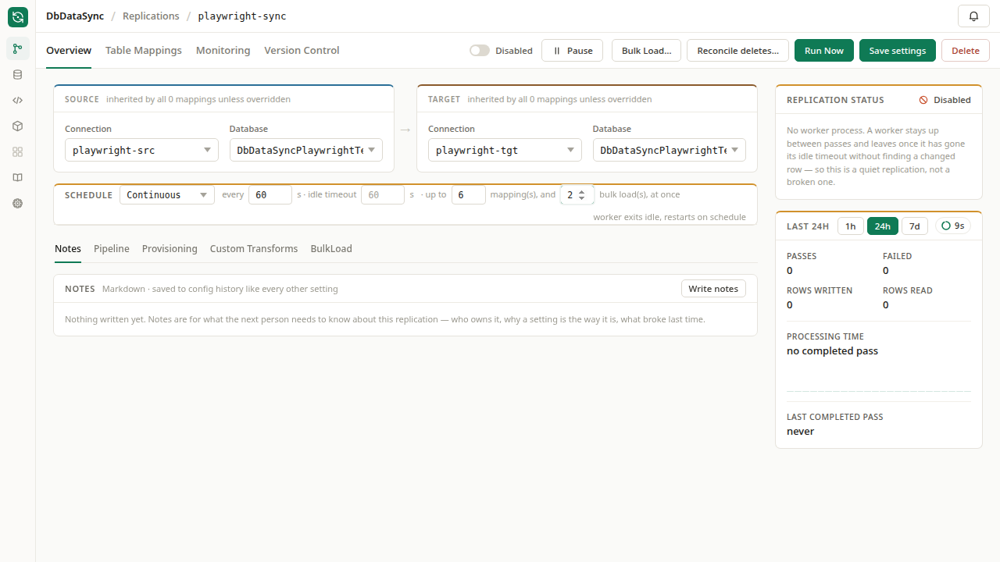
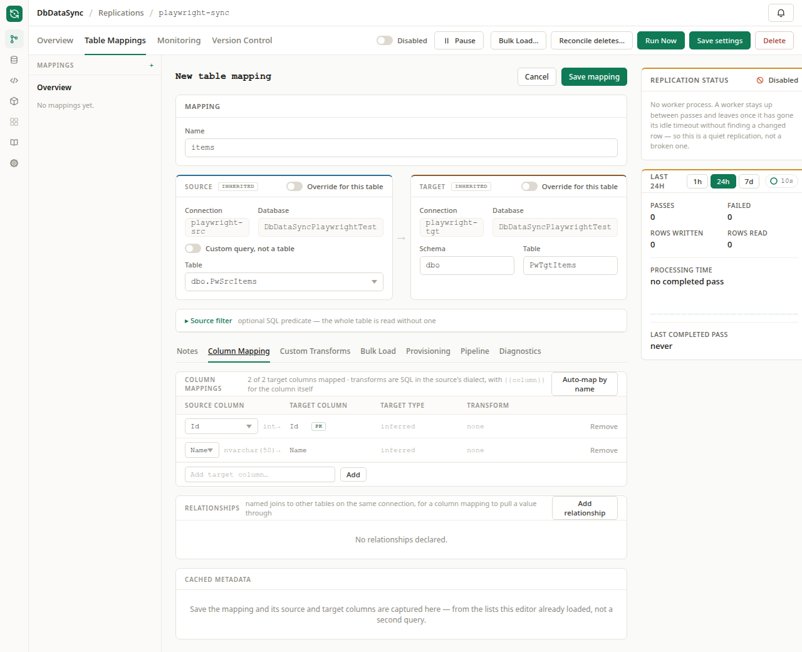
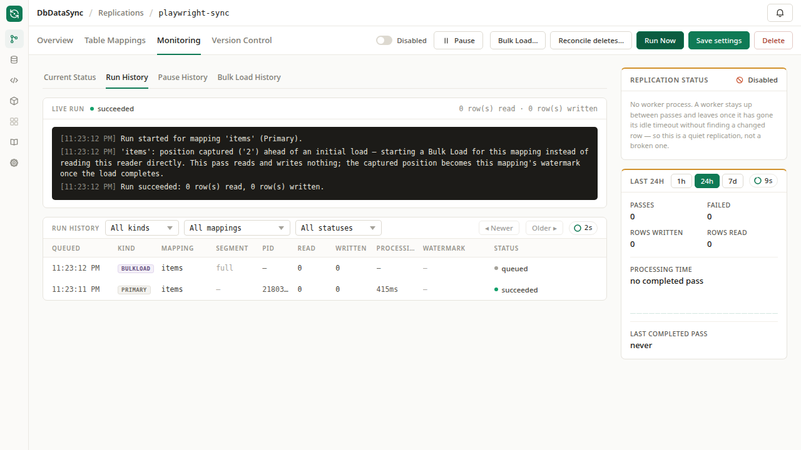
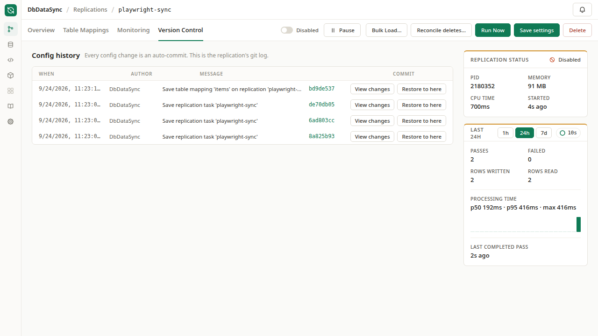
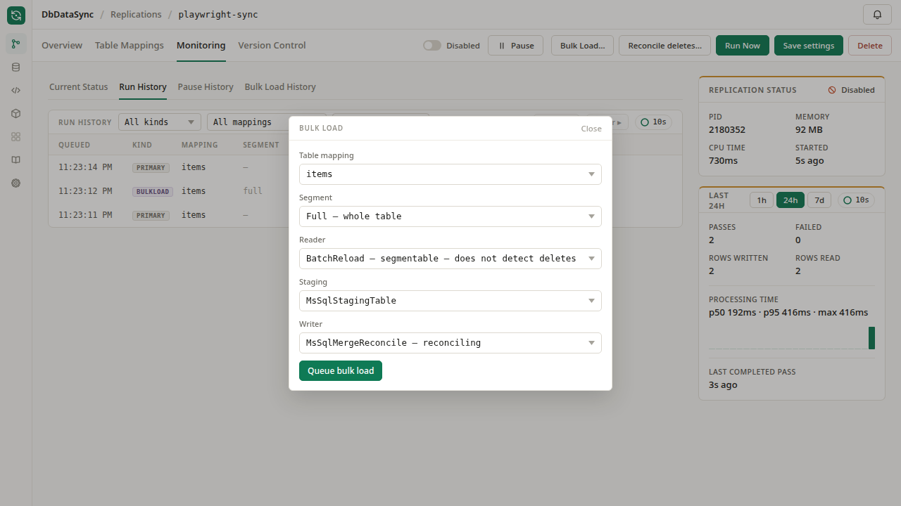
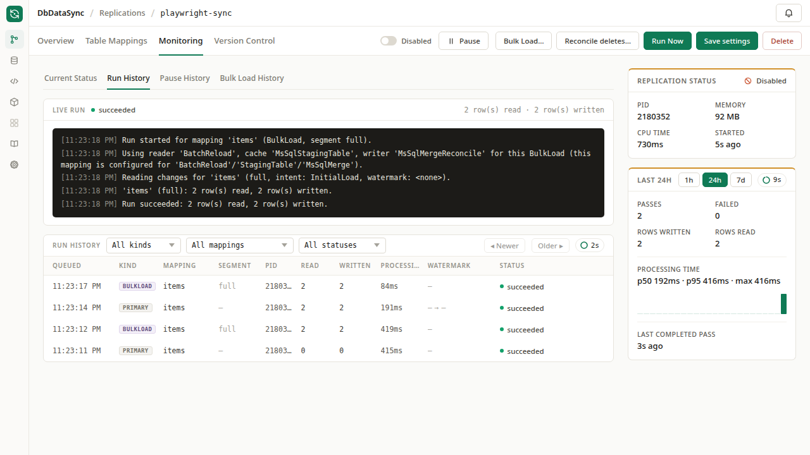

# Getting started

[DbDataSync](../README.md) · [Install](install.md) · [Configuration](configuration.md) · **Getting started** · [Replication concepts](replication-concepts.md) · [Drivers and libraries](drivers-and-libraries.md) · [State database](state-database.md) · [Building from source](development.md)

This walks through setting up your first replication. If you haven't installed DbDataSync yet, see
[Install](install.md) first. Everything below happens in the web app of the dbdatakit console, once DbDataSync is running and paired with it.

## Open the server in the console

DbDataSync serves no web app of its own; its screens are the console's, which manages every DbData server (Sync, Build, Proxy) from one place.

1. **Start the console.** `dbdatakit server run` (see `DbDataConsole/README.md` in the repository) writes a first-run invitation to `FIRST-RUN.txt` in its directory and its log.
   Open `https://localhost:8480/invite#<code>` once and make a passkey: you are the first administrator.
2. **Make a pairing code on the server.** `dbdatasync server pair` prints a single-use code. The console must reach the server over HTTPS
   (see [Install](install.md#connecting-a-console)).
3. **Pair them.** In the console, **Servers → Pair a server**: the server's address and the code (or `dbdatakit instance add <https address> --code <code>`).
   The console pins the server's certificate; the server's list of paired consoles is `dbdatasync server clients`.
4. **Open it.** The server's row has an **Open** link: its screens are at `/servers/<id>/...` in the console, and a link to one can be bookmarked and shared with anyone who can sign in to the console.

What a person may do on the server follows from their role in the console (an administrator everything, a viewer reading), limited by the most the console was allowed to grant when it was paired.

## Reading these docs in the console

Everything in this documentation is also in the console. **Docs** on the console's left rail lists the docs of every product it has screens for, and DbDataSync's are
at `/docs/sync`; the **Docs** icon on a Sync screen's own rail opens the same pages inside the server's screens. They are the files of this folder as they were when the
console was built, so they need no network (they work on a machine that cannot reach GitHub), and they describe the console's version of the docs, which is the one
that shipped with the pages you are reading in the app. They are there for every signed-in user, not only administrators.

## Your first replication

1. **Connections.** Add a `SQL Auth` connection for each of your two SQL Server instances.

   

2. **Replications → New Replication.** Name the replication and pick its source and target connection
   and database. Leave the schedule set to `Continuous` for now.

   

3. Open the replication, then go to **Table Mappings → New Table Mapping**. Pick the source and
   target table using the pickers. DbDataSync suggests column mappings automatically for columns with
   matching names.

   

4. **Runs → Run Now.** Watch the log and status update in real time.

   

5. Open the **Version Control** tab to see the git log of every config change. DbDataSync commits
   automatically every time you save, so this log also works as an audit trail.

   

### Telling DbDataSync a table's primary key

A table mapping uses the source's own primary key where it has one. A view, an ODBC source or a Flight SQL
proxy often reports none, so the target table would be created without a key. On the mapping's **Column
mapping** tab, **Primary key** lets you tick the columns that form the key. They replace whatever the
source reports, and they decide the `PRIMARY KEY` in a generated `CREATE TABLE` (those columns are always
created `NOT NULL`, even if the source calls them nullable), the key an SCD Type 2 writer versions rows by,
and the key a key-based delete reconcile matches on. Only columns the mapping carries across can be chosen.
The order matters — it is the order of the index — so a composite key is listed in order and you can move
columns up and down. Columns are added at the end in the order you tick them.

## Bulk loading a table

Incremental sync only applies changes made at the source. If the target drifts for some other
reason — a bad deploy, a manual edit, a mapping that was wrong for a while — use a bulk load instead.
Go to **Runs → Bulk Load…**. It re-reads the source and makes the target match it.



A bulk load applies to one table mapping, and optionally to just one segment of it: a list of values, a
range, an even split of a column's range into buckets, or a custom segmenting strategy (below). Each
segment runs as its own independently queued run. A bulk load never advances the incremental watermark,
so it can run against a live, scheduled replication without disturbing the ongoing sync. It shows up
in the same run history as the regular sync, tagged `BULKLOAD`.



Each mapping has a *Default reload segmenting* setting, in its own editor, that states how it divides
for a reload. The Bulk Load form opens pre-filled with that default, and a scheduled `BatchReload` pass
uses it too. Leaving it empty means the whole table, unsegmented.

### Custom segmenting strategies

`Auto` splits a column's value range into evenly sized buckets. That works until the boundaries need
to mean something — a calendar month, say, which isn't a fixed number of days. For that, a replication
can define named strategies, under **Overview → Settings**, that propose segments a different way.
There are four ways to author one:

- **DuckDB SQL** — runs against an ephemeral in-memory DuckDB and touches neither database. Good for
  a table whose write pattern you already know:

  ```sql
  SELECT strftime(d, '%Y-%m')       AS label,
         d                          AS range_start,
         d + INTERVAL 1 MONTH       AS range_end,
         d >= current_date - INTERVAL 3 MONTH AS selected
  FROM generate_series(DATE '2020-01-01', current_date, INTERVAL 1 MONTH) AS t(d)
  ```

- **Source SQL** / **Target SQL** — the same four columns, queried from the live source or from a
  control table on the target.
- **C#** — a bound `ISegmentingStrategy`, handed both connections and the source's metadata.

`label` names the segment in run history. `range_start`/`range_end` are half-open. `selected` decides
which candidates start ticked in the Bulk Load checklist, and, for a mapping whose default is a
strategy, which segments a scheduled pass reloads on its own. A strategy such as "the last three
months" is re-evaluated against the current date every time it runs, so it needs no separate
scheduling logic.

If a mapping's default strategy queries a real database, that query runs on every scheduled pass. The
mapping editor notes this next to the picker. Whether that's acceptable depends on your tables, so
DbDataSync leaves that judgment to you.

The reader, staging, and writer pickers — here and under **Overview → Settings** — only list what the
connection's driver actually supports. This includes which readers can be segmented, and which writers
*reconcile*: removing target rows the source no longer has, rather than only inserting and updating.

A replication can also be a standalone reload instead of an incremental sync. Set its reader to
`MsSqlBatchReload` and give each mapping a *Default reload segmenting* list; it re-reads that list on
its normal schedule.

> **Breaking change.** The `segments` reader option — a JSON array typed directly into the reader's
> settings — is no longer read. Segmenting now lives on the table mapping, where it has a proper
> editor. A config that still has that option behaves as though it had none (full table, unsegmented)
> until you fill in the mapping's *Default reload segmenting*. There is no automatic conversion between
> the two.

## Next: Replication concepts

The walkthrough above used the defaults. See [Replication concepts](replication-concepts.md) for the
full picture — every reader kind, how a first-ever load actually runs, and delete reconciliation.
