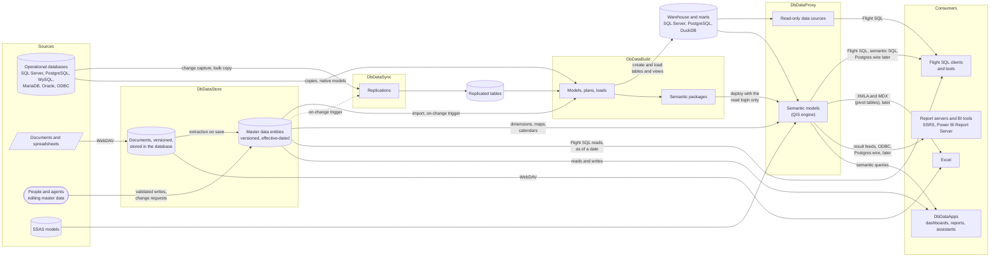
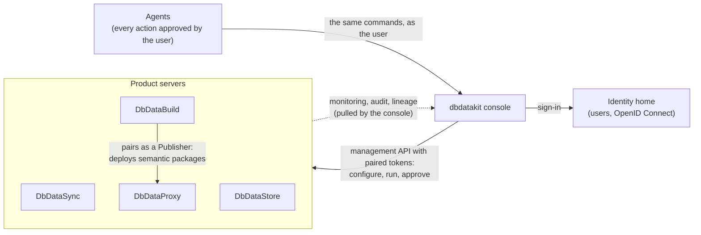

# How data flows through the suite (future state)

A high-level picture of the planned suite: where data enters, which product moves or shapes it, and who reads it. It is drawn from
plans 13 to 19 (`docs/plans/`). Some parts are not built yet; the labels say "later" where a plan schedules them after the first version.

## Data

Reading it left to right:

- **Sync** copies operational data into replicated tables.
- **DbDataStore** holds the data people own (master data and documents), with history. It extracts tables from documents as they are saved.
- **Build** turns replicated tables, sources and entities into the warehouse. It also authors the semantic packages and deploys them to
  Proxy with the read login only; the write login never leaves Build.
- **Proxy** serves the warehouse and the semantic models: Flight SQL now, with Postgres wire and XMLA for Excel later. The semantic models
  can also read SSAS and DbDataStore's entities.
- **DbDataStore** also serves its own entities over the same shared protocol code (Flight SQL, WebDAV).
- **DbDataApps, report servers, Excel and tools** read from Proxy and DbDataStore; they never reach the databases directly.

## Control

The data paths above are managed, monitored and traced from one place. A console calls the servers; a server never calls a console.

- **Monitoring and lineage are pulled.** Each server keeps its own runs, audit and lineage, and the console joins them (plans 13 W10 and 18).
- **One server-to-server path.** Build pairs with Proxy as a client so it can deploy semantic packages (plan 13 W12).
