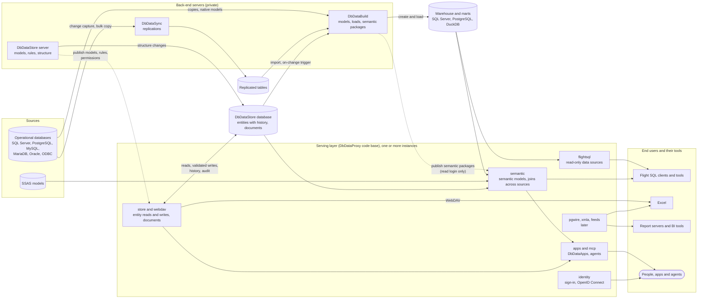
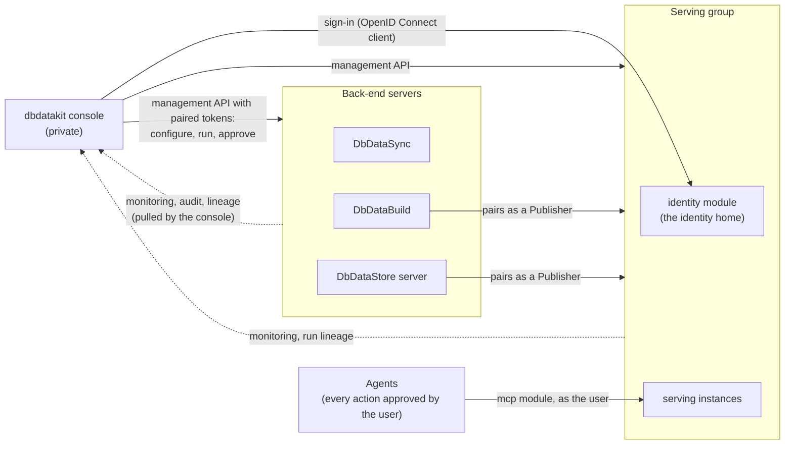

# How data flows through the suite (future state)

A high-level picture of the planned suite: where data enters, which product moves or shapes it, and who reads it. It is drawn from
plans 13 to 20 (`docs/plans/`), with plan 20's single serving layer as the only edge end users reach. Some parts are not built yet; the
labels say "later" where a plan schedules them after the first version.

## Data

Reading it left to right:

- **Sync** copies operational data into replicated tables.
- **Build** turns replicated tables, sources and DbDataStore's entities into the warehouse. It publishes semantic packages to the serving
  layer with the read login only; the write login never leaves Build.
- **DbDataStore's server** owns the master data models, rules and structure changes, and publishes them to the serving layer.
- **The serving layer** is the only thing end users reach. It reads the warehouse, SSAS and DbDataStore's database directly, and it
  writes DbDataStore's data through DbDataStore's own write path (validation, history, audit). It also hosts sign-in, apps and the
  agents' endpoint.
- Because it runs from published definitions, it keeps serving while the back-end servers are patched (plan 20, section 5). Dotted lines
  are publishes; solid lines are data.

## Control

The data paths above are managed, monitored and traced from one place. A console calls the servers; a server never calls a console.

- **Monitoring and lineage are pulled.** Each server keeps its own runs, audit and lineage, and the console joins them (plans 13 W10 and 18).
- **Publishers.** Build and DbDataStore's server pair with the serving group as Publishers (plan 13 W12, plan 20 section 6).
- **Identity faces users.** The identity home is a module of the serving group, so end users sign in without reaching the console. It can
  also run on its own behind the firewall, with the serving layer forwarding its endpoints.
